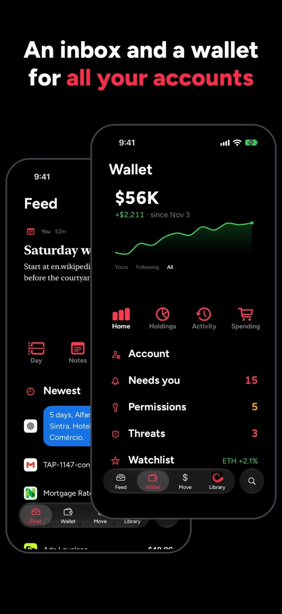
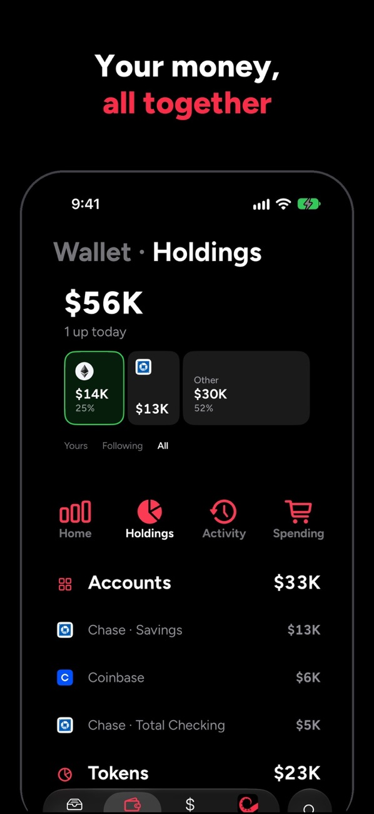
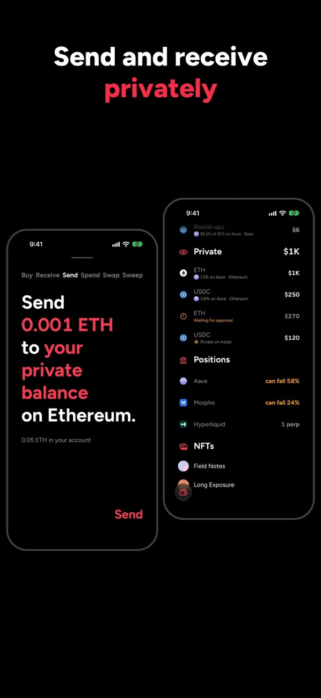

# Casberi

[](https://github.com/alexanderchopan/casberi/actions/workflows/static-checks.yml)
[](https://github.com/alexanderchopan/casberi/actions/workflows/engine-reproducibility.yml)

**Keep it Moving, Privately.**

Your life and money are spread across accounts. You spend the day switching between apps to get anything done. Casberi gives you an inbox and a wallet to keep it all moving, privately.

A native app for iPhone, iPad and Mac, with a self-custody wallet. Live on the App Store; site at [casberi.app](https://casberi.app).

<p>
  
  
  
</p>

Casberi holds keys and signs transactions. To report a vulnerability, see [`SECURITY.md`](SECURITY.md).

## Repository map

| Path | What it holds |
| --- | --- |
| `Casberi/` | The Xcode project and all app source. |
| `Casberi/Casberi/` | The app: `Model/` (logic, bridges, wallet), `Screens/`, `Shell/`, `Design/`, `GenUI/`, `Resources/`. |
| `Casberi/Shared/` | Source compiled into both the app and its extensions (the data model, the shared store). |
| `Casberi/ShareExtension/`, `CasberiWidgets/`, `NotificationContent/` | The extensions. |
| `Casberi/CasberiTests/`, `CasberiUITests/` | Tests that need a real model container. |
| `Vendor/` | Vendored dependencies and where each comes from. See [`Vendor/README.md`](Vendor/README.md). |
| `tools/` | JavaScript engines bundled into the app, and the spikes that measured them. See [`tools/README.md`](tools/README.md). |
| `scripts/` | The verification suite and release tooling. See [`scripts/README.md`](scripts/README.md). |
| `docs/` | Rulings, specs and build records. See [`docs/README.md`](docs/README.md). |
| `website/` | casberi.app, published by GitHub Pages. |
| `design/app-icon/` | Icon sources. |
| `.github/workflows/` | CI: static checks, logic self-tests, site integrity, Pages. |

## Where to look in a security review

| Area | Files |
| --- | --- |
| The account's signing path | `Casberi/Casberi/Model/YourAccount*.swift`, `Model/Safe*.swift`, `Model/SignerKey.swift`, `Screens/Move*.swift` |
| What a signature is shown as before it is made | `Model/ClearSign.swift`, `Model/SafeSignChecks.swift`, `Model/MoveWarnings.swift`, `Model/YourAccountPreview.swift` |
| Key and credential storage | `Model/TokenVault.swift`, `Model/SafeEnclaveKey.swift`, `Model/YourAccountKey.swift` |
| Every host the app may contact | `Model/NetworkReach.swift` (declared), `Model/NetworkLedger.swift` (recorded at runtime) |
| Private-money engines | `tools/aztec-engine/`, `tools/privacy-pools-engine/`, `tools/railgun-engine/`, built into `Casberi/Casberi/Resources/*-engine.js` |
| Start here | `docs/architecture.md`: what the app holds, what signs, what leaves the device, what it trusts |
| Check the claims | [`docs/verify-it-yourself.md`](docs/verify-it-yourself.md): one command per claim, with the output to expect |
| Every host contacted | [`docs/hosts.md`](docs/hosts.md): generated from the code |
| Every dependency | [`docs/dependencies.md`](docs/dependencies.md): version, source and licence |
| Specs | `docs/specs/signing-safety-spec.md`, `safe-wallet-spec.md`, `signer-spec.md`, `aztec-security-model.md` |

The checks that guard these areas run on every pass and in CI. The ones to read first: `scripts/keychain-audit.py`, `scripts/network-reach-audit.sh`, `scripts/safe-signer-selftest.sh`, `scripts/clearsign-selftest.sh`, `scripts/secret-scan-selftest.py`, `scripts/redaction-coverage-audit.py`. `docs/verify.md` says what each one catches.

No signing key, user credential or developer key is committed. Development keys live in the developer's login Keychain (`scripts/dev-keys.sh`). Two shared read-only data keys (Alchemy, Zerion) ship in the binary and are in the source on purpose, beside public identifiers such as the WalletConnect project id; `docs/architecture.md` says where.

## Building

Requires Xcode 27 and macOS with an iPhone simulator. Two dependencies are fetched rather than committed:

```sh
scripts/tdlib.sh
```

```sh
scripts/aztec-engine.sh
```

Then build:

```sh
scripts/xcb.sh -project Casberi/Casberi.xcodeproj -scheme Casberi -destination "id=$(scripts/sim-device.py)" build
```

Run every check (build, Mac Catalyst, audits, self-tests, simulator sweep):

```sh
scripts/verify.sh
```

The static audits and logic self-tests need no simulator and run on their own; each accepts `--self-test`.

## How the project is run

One developer, commits straight to `main`. Each shipped build is recorded in [`docs/builds.md`](docs/builds.md) with the commit it was archived from, and a build made from a clean tree is tagged `build-<n>`. Product and design decisions are recorded as numbered rulings in `docs/prd.md` and cited in code as `prd §N`; `docs/law.md` is the current summary. `.claude/CLAUDE.md` is the working rule sheet for AI coding sessions; it imports `docs/hooks/index.md`, the index of the DEBUG launch hooks. Unfamiliar words are in [`docs/glossary.md`](docs/glossary.md).

## License

Copyright (C) 2026 Alexander Chopan.

Casberi is free software: you can redistribute it and/or modify it under the terms of the GNU General Public License as published by the Free Software Foundation, either version 3 of the License, or (at your option) any later version. See `LICENSE`.

**Additional permission under GNU GPL version 3 section 7.** If you modify this program, or any covered work, by linking or combining it with Reown's `reown-swift` SDK (or a modified version of that library), containing parts covered by the terms of the WalletConnect Community License Agreement, the licensors of this program grant you additional permission to convey the resulting work.

The license covers the code. The Casberi name, app icon and logo are not licensed: a fork must use its own.

Third-party code bundled with the app, and its licences, are listed in [`Casberi/Casberi/Resources/Licenses.md`](Casberi/Casberi/Resources/Licenses.md).

## Contributing

Casberi does not take outside contributions. See [`CONTRIBUTING.md`](CONTRIBUTING.md).
